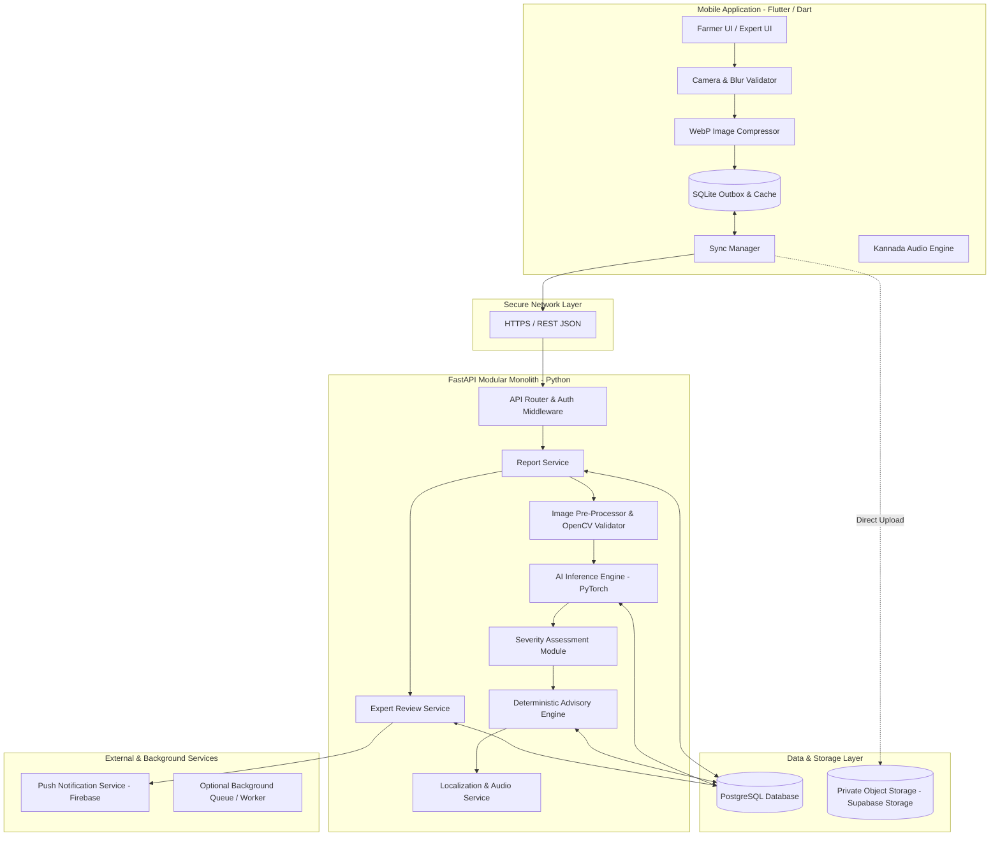
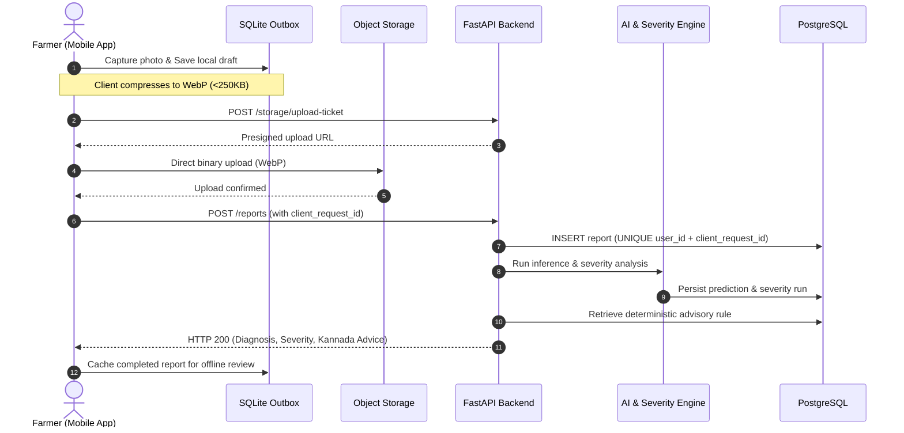
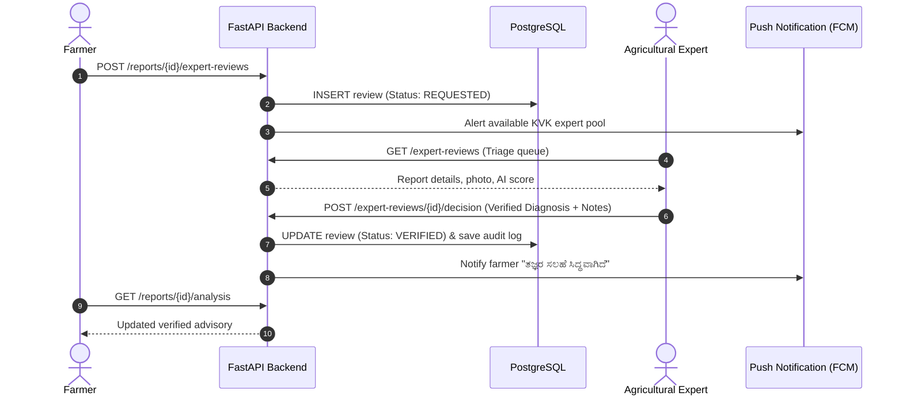
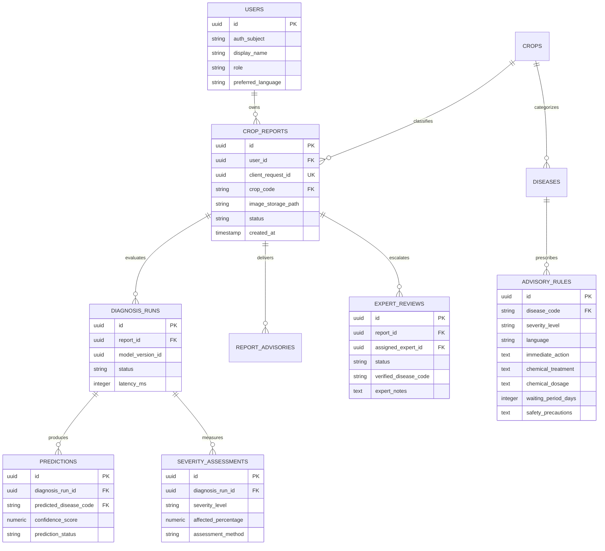

# System Architecture Document

**Project:** KrishiPragnya  
**Problem Statement:** PS-3 — Crop Disease Detection for Small Farmers  
**Architecture Style:** Modular Monolith with Offline-First Mobile Client  
**Document Version:** 1.0.0  
**Status:** Architecture Blueprint Approved (Setup & Planning Phase; Implementation Pending)  

---

## 1. High-Level Architecture Overview

KrishiPragnya is engineered as an **offline-first distributed system** centered on a modular monolith backend. The system minimizes rural network bottlenecks by performing pre-flight validation and image compression directly on the mobile device, utilizing an idempotent Outbox pattern to withstand flaky cellular links, and executing inference and deterministic advisory generation server-side.



---

## 2. Component Implementation Status

| Component | Technology | Proposed vs. Implemented Status | Role & Responsibility |
|:---|:---|:---|:---|
| **Mobile App Scaffold** | Flutter 3.47.7 / Dart 3.13.5 | **Implemented (Base Scaffold)** | Cross-platform client application baseline in `mobile/`. |
| **Mobile UI & Workflows** | Flutter Material 3 | *Proposed (Phase 2–4)* | Farmer screens, crop selection, result presentation, audio player. |
| **Offline Storage** | SQLite (`sqflite` / `drift`) | *Proposed (Phase 8)* | Local persistence of drafts, offline reports, and cached advisories. |
| **Client Compression** | Dart / Native Canvas | *Proposed (Phase 4)* | Downsampling camera images to max 1024px WebP $\le 250\text{ KB}$. |
| **Backend API** | Python 3.12 + FastAPI | *Proposed (Phase 5)* | High-performance, typed RESTful API gateway and modular services. |
| **Database** | PostgreSQL (Supabase candidate) | *Proposed (Phase 5)* | Relational persistence for reports, predictions, rules, and reviews. |
| **Object Storage** | S3-Compatible / Supabase Storage | *Proposed (Phase 5)* | Secure, private storage for compressed photographs and thumbnails. |
| **Image Pre-Processing** | OpenCV (`cv2`) + Pillow | *Proposed (Phase 6)* | Resolution validation, format decoding, and color space transform. |
| **AI Inference** | PyTorch / TorchScript | *Proposed (Phase 6)* | Multi-class crop disease classification with confidence thresholding. |
| **Severity Engine** | Python Rule & Mask Engine | *Proposed (Phase 7)* | Decoupled lesion area quantification and urgency categorization. |
| **Advisory Engine** | Deterministic Knowledge Base | *Proposed (Phase 7)* | Safe, audited treatment retrieval with zero generative hallucination. |
| **Expert Review Portal** | Web / Mobile Expert View | *Proposed (Phase 9)* | Triage dashboard for agricultural scientists to review ambiguous cases. |

> [!NOTE]
> Microservices, Apache Kafka, and Kubernetes are explicitly deferred. A well-structured modular monolith satisfies all latency, throughput, and operational criteria for smallholder deployment while eliminating distributed failure overhead.

---

## 3. Communication Protocols & API Boundaries

### 3.1 Protocol Principles
- All client-server communication is conducted via **HTTPS REST/JSON**.
- Image binary transfers bypass the API application server where possible by using **presigned upload URLs** directly to private object storage.
- All mutating endpoints require a client-generated **Idempotency Key (UUIDv4)** to prevent duplicate submissions during network retries.

### 3.2 Proposed Core API Contracts

#### A. Storage Ticket Authorization
```http
POST /api/v1/storage/upload-ticket
Authorization: Bearer <token>
Content-Type: application/json

Request:
{
  "client_request_id": "c1f7b822-48a1-432d-98d9-21df348e3d09",
  "crop_code": "paddy",
  "content_type": "image/webp",
  "file_size_bytes": 142850
}

Response (200 OK):
{
  "upload_url": "https://storage.provider.com/upload/sign/...",
  "storage_path": "reports/paddy/2026/10/c1f7b822...webp",
  "expires_in_seconds": 900
}
```

#### B. Submit Crop Report
```http
POST /api/v1/reports
Authorization: Bearer <token>
Content-Type: application/json

Request:
{
  "client_request_id": "c1f7b822-48a1-432d-98d9-21df348e3d09",
  "crop_code": "paddy",
  "image_storage_path": "reports/paddy/2026/10/c1f7b822...webp",
  "language": "kn",
  "district": "Mandya"
}

Response (201 Created or 200 OK on Idempotent Replay):
{
  "report_id": "9d4f0cb1-64d8-4f18-a621-e304918ef9b3",
  "client_request_id": "c1f7b822-48a1-432d-98d9-21df348e3d09",
  "status": "SUBMITTED",
  "created_at": "2026-10-20T00:45:00Z"
}
```

#### C. Request & Retrieve Analysis
```http
GET /api/v1/reports/{report_id}/analysis
Authorization: Bearer <token>

Response (200 OK):
{
  "report_id": "9d4f0cb1-64d8-4f18-a621-e304918ef9b3",
  "status": "COMPLETED",
  "diagnosis": {
    "disease_code": "paddy_blast",
    "name_kn": "ಭತ್ತದ ಬೆಂಕಿ ರೋಗ (ಬ್ಲಾಸ್ಟ್)",
    "name_en": "Paddy Blast",
    "confidence": 0.895,
    "prediction_status": "ACCEPTED"
  },
  "severity": {
    "level": "MODERATE",
    "level_kn": "ಮಧ್ಯಮ ಹಂತ",
    "affected_percentage": 18.5,
    "assessment_method": "cv_lesion_mask_v1"
  },
  "advisory": {
    "title_kn": "ಶಿಫಾರಸು ಮಾಡಿದ ನಿರ್ವಹಣಾ ಕ್ರಮಗಳು",
    "immediate_action": "ರೋಗಪೀಡಿತ ಎಲೆಗಳನ್ನು ತೆಗೆದು ನಾಶಮಾಡಿ. ಗದ್ದೆಯಲ್ಲಿ ನಿಂತ ನೀರನ್ನು ತಾತ್ಕಾಲಿಕವಾಗಿ ಹೊರಹಾಕಿ.",
    "cultural_practice": "ಸಾರಜನಕ ಗೊಬ್ಬರದ ಬಳಕೆಯನ್ನು ತಾತ್ಕಾಲಿಕವಾಗಿ ಕಡಿಮೆ ಮಾಡಿ.",
    "chemical_treatment": "ಟ್ರೈಸೈಕ್ಲಾಜೋಲ್ 75 WP (Tricyclazole 75 WP)",
    "dosage": "0.6 ಗ್ರಾಂ ಪ್ರತಿ 1 ಲೀಟರ್ ನೀರಿಗೆ ಬೆರೆಸಿ ಸಿಂಪಡಿಸಿ.",
    "safety_precautions": "ಮುಖಗವಸು ಧರಿಸಿ. ಕೊಯ್ಲಿಗೆ 21 ದಿನಗಳ ಮೊದಲು ಬಳಸಬೇಡಿ (PHI: 21 ದಿನಗಳು).",
    "audio_url": "https://storage.provider.com/audio/paddy_blast_kn.mp3",
    "source_reference": "UAS Bangalore Package of Practices 2024"
  },
  "expert_review": {
    "is_available": true,
    "review_status": "NOT_REQUESTED"
  }
}
```

#### D. Request Expert Review
```http
POST /api/v1/reports/{report_id}/expert-reviews
Authorization: Bearer <token>

Request:
{
  "reason": "FARMER_UNCERTAIN",
  "farmer_note": "ಎಲೆಯ ತುದಿಯಲ್ಲಿ ಕಂದು ಬಣ್ಣ ಹೆಚ್ಚಾಗಿದೆ."
}

Response (202 Accepted):
{
  "review_id": "rev-550e8400-e29b-41d4-a716-446655440000",
  "status": "REQUESTED",
  "created_at": "2026-10-20T00:50:00Z"
}
```

---

## 4. End-to-End Execution Workflows

### 4.1 Diagnosis & Advisory Sequence Diagram



### 4.2 Expert Review & Escalation Workflow



---

## 5. Data Model & Entity Relationships (Proposed)

The database schema decouples reports from analysis runs and advisories to allow multi-run history without data overwriting:



---

## 6. Security, Authorization & Error Handling

### 6.1 Security Architecture
- **Authentication:** Token-based authentication using managed JWTs (e.g., Supabase Auth or OAuth2).
- **Authorization:** Strict Role-Based Access Control (RBAC):
  - `farmer`: Allowed only to access and mutate their own reports and requests.
  - `expert`: Authorized to access triage queues, inspect assigned cases, and record verified decisions.
  - `admin`: Authorized to register model versions and update approved advisory rules.
- **Image Protection:** Images are stored in private storage buckets. Public access is disabled; client retrieval uses short-lived signed URLs (15-minute TTL).
- **Zero Secrets in Code:** Database connection URIs, storage keys, and service tokens are provided exclusively via environment variables (`.env`).

### 6.2 Error Handling & Resilience
- **Idempotency Defense:** `UNIQUE(user_id, client_request_id)` constraint ensures that network timeouts resulting in client retries return the original record instead of duplicating records.
- **Fail-Safe AI Degradation:** If the model inference fails, times out, or encounters non-plant inputs, the system assigns status `UNCERTAIN` or `REJECTED`, explains the issue in clear Kannada, and prevents any unverified chemical advice from being displayed.
- **Structured Error Responses:** All API errors adhere to standard RFC 7807 problem details with localized error codes (`ERR_IMAGE_BLURRY`, `ERR_UNSUPPORTED_CROP`, `ERR_TIMEOUT`).

---

## 7. Deployment & Testing Strategy

### 7.1 Backend Deployment
- Packaged as a standard Docker container running Uvicorn + FastAPI.
- Deployed on a managed cloud platform (e.g., Supabase PostgreSQL + compute instance or container app).
- Storage hosted on private S3-compatible object storage.

### 7.2 Testing Strategy
1. **Unit Tests:**
   - Image validation routines (OpenCV dimension, blur variance).
   - Severity calculation algorithms and threshold mapping.
   - Advisory rule matching and dosage constraints.
2. **Integration Tests:**
   - FastAPI endpoint integration testing with a test database.
   - Idempotency replay testing.
   - Presigned upload ticket lifecycle.
3. **Mobile Client Tests:**
   - Flutter widget smoke tests.
   - SQLite outbox insert/update/delete operations.
   - Localization fallback (switching `kn` $\leftrightarrow$ `en`).
