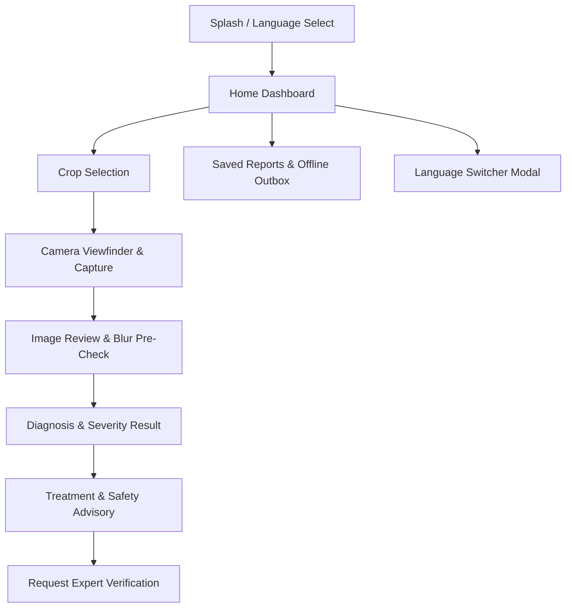

# UI/UX Design Specification

**Project:** KrishiPragnya  
**Problem Statement:** PS-3 — Crop Disease Detection for Small Farmers  
**Target Platform:** Android-First Mobile (Flutter)  
**Document Version:** 1.0.0  
**Status:** Design Specification Only (Implementation Pending — Do NOT Implement Yet)  

---

## 1. Design Philosophy & Farmer-First Principles

Smallholder farmers operate under distinct physical and cognitive environments:
- **Outdoor Sunlight:** Strong ambient sunlight makes low-contrast screens unreadable.
- **Field Ergonomics:** Hands may be wet or soil-stained; one-handed smartphone use is frequent.
- **Literacy & Technical Familiarity:** Complex multi-nested menus and fine text cause drop-off. The interface must be visually guided, icon-supported, and audibly accessible.
- **Direct Feedback:** Farmers require clear, immediate visual confirmation of whether an action succeeded, failed, or is saved locally.

---

## 2. Visual Design System

### 2.1 Color Palette
The color system reflects agriculture while maintaining WCAG AAA contrast ratios against bright sunlight:

| Token | Hex Value | Semantic Role | Rationale |
|:---|:---|:---|:---|
| **Primary 900** | `#0D3813` | Deep Forest Green / Headers | High contrast text and top app bar |
| **Primary 700** | `#1B5E20` | Brand Primary / Primary Buttons | Grounded agricultural tone |
| **Primary 500** | `#2E7D32` | Interactive Green / Healthy State | Vibrant green for success and healthy plants |
| **Accent Gold** | `#D97706` | Warning / Moderate Urgency | Golden amber for moderate attention |
| **Alert Red** | `#DC2626` | High Severity / Error / Danger | Urgent alert and high infection spread |
| **Neutral 50** | `#F7FAF5` | Background Tint | Soft organic sage/white; reduces eye fatigue |
| **Neutral 100** | `#EDF2E8` | Card Surfaces & Dividers | Subtle contrast for containment cards |
| **Neutral 900** | `#1E293B` | Primary Body Text | High contrast charcoal on light surfaces |

### 2.2 Typography
- **Primary Typeface:** Google Font `Noto Sans Kannada` paired with `Roboto` / `Inter` for numbers and Latin characters.
- **Scale Hierarchy:**
  - **Display Title:** 24–28sp, Bold (App titles, primary diagnosis outcome).
  - **Section Heading:** 18–20sp, Semi-Bold (Card headers, severity level).
  - **Body Primary:** 15–16sp, Regular, 1.5 line height (Advisories, instruction text).
  - **Caption / Metadata:** 12–13sp, Medium (Timestamps, confidence percentages).
- **Readability Rule:** Minimum font size for critical agricultural dosage instructions is **15sp**. Never render chemical advice in sub-14sp text.

### 2.3 Component System Specifications
- **Touch Targets:** Minimum $48\times 48\text{ dp}$ for all clickable buttons, icon buttons, and list items.
- **Elevation & Corners:** Rounded corners ($16\text{ dp}$–$24\text{ dp}$) on cards and dialogs; soft, low-blur elevation ($2\text{ dp}$–$4\text{ dp}$) to conserve GPU rendering on budget Android chipsets.
- **Buttons:**
  - *Primary Button:* Solid Primary Green (`#1B5E20`), White bold text, $52\text{ dp}$ height, full-width or prominent.
  - *Secondary / Outlined:* White background with $1.5\text{ dp}$ Primary Green border, $48\text{ dp}$ height.
  - *Audio Button:* Distinctive pill chip with speaker icon and pulse indicator.

---

## 3. Information Architecture & Navigation

The navigation hierarchy is kept intentionally shallow (maximum 2 levels deep) to prevent users from getting lost:

---

## 4. Screen-by-Screen Specifications (Proposed)

### Screen 1: Language Selection & Onboarding
- **Purpose:** Allow the farmer to pick their preferred language on first launch.
- **Elements:**
  - Prominent KrishiPragnya brand mark and sprout/magnifier emblem.
  - Two large touch cards: **ಕನ್ನಡ (Kannada)** and **English**.
  - Audio snippet that greets the user in Kannada: *"ಕೃಷಿ ಪ್ರಜ್ಞಾಗೆ ಸುಸ್ವಾಗತ"* (Welcome to KrishiPragnya).
  - Big "ಮುಂದುವರಿಯಿರಿ / Continue" button.

### Screen 2: Home Screen
- **Purpose:** Central launchpad for starting a new crop scan or viewing past records.
- **Elements:**
  - Header with app title, language toggle button (`ಕನ್ನಡ / EN`), and offline status badge (`ಆನ್‌ಲೈನ್` / `ಆಫ್‌ಲೈನ್`).
  - Hero Action Card: "ಬೆಳೆ ರೋಗ ಪತ್ತೆ (Scan Plant Leaf)" with a large camera icon.
  - Supported Crops Carousel: Quick filter by Paddy (ಭತ್ತ), Tomato (ಟೊಮೇಟೊ), Ragi (ರಾಗಿ).
  - Recent Reports List: Snapshot cards of previous scans with status chips (`ಪೂರ್ಣಗೊಂಡಿದೆ`, `ಬಾಕಿ ಇದೆ`).

### Screen 3: Camera Capture & Live Guidance
- **Purpose:** Capture a high-quality photograph of a single affected leaf.
- **Elements:**
  - Live camera preview with a center-aligned leaf framing overlay (dashed green rectangle).
  - Text banner at top: *"ಒಂದು ಎಲೆಯನ್ನು ಚೌಕಟ್ಟಿನಲ್ಲಿ ಸ್ಪಷ್ಟವಾಗಿ ಇರಿಸಿ"* (Align one leaf clearly in the box).
  - Real-time flash/torch toggle for shaded fields.
  - Big circular capture button.
  - Gallery upload alternative button.

### Screen 4: Image Confirmation & Pre-Flight Check
- **Purpose:** Prevent blurry or unreadable uploads before consuming bandwidth.
- **Elements:**
  - Full-screen review of the captured photograph.
  - Local blur assessment: If blurry, shows amber warning: *"ಚಿತ್ರವು ಮಸುಕಾಗಿದೆ. ದಯವಿಟ್ಟು ಸ್ಪಷ್ಟವಾದ ಫೋಟೋ ತೆಗೆಯಿರಿ"* (Image is blurry. Please retake) with "ಮತ್ತೆ ತೆಗೆಯಿರಿ (Retake)" and "ಮುಂದುವರಿಯಿರಿ (Use Anyway)" options.

### Screen 5: Diagnosis & Severity Results Screen
- **Purpose:** Present the identified disease and urgency level clearly.
- **Elements:**
  - Thumbnail of the submitted leaf.
  - Disease Common Name in Kannada (e.g., **ಭತ್ತದ ಬೆಂಕಿ ರೋಗ**) and English (**Paddy Blast**).
  - Confidence Indicator: Simple visual meter showing certainty (`ಖಚಿತ / High`, `ಸಾಧಾರಣ / Moderate`, `ಅನಿಶ್ಚಿತ / Uncertain`).
  - Severity Card:
    - `ಕಡಿಮೆ (Low)`: Green badge.
    - `ಮಧ್ಯಮ (Moderate)`: Amber badge (symptoms spreading).
    - `ತೀವ್ರ (High)`: Red badge (urgent intervention needed).
  - Audio Button: "ಧ್ವನಿ ಮೂಲಕ ಆಲಿಸಿ (Listen to Diagnosis)".

### Screen 6: Evidence-Based Treatment Advisory Screen
- **Purpose:** Deliver actionable, safe agricultural guidance.
- **Elements:**
  - **Section 1: ತಕ್ಷಣದ ಕ್ರಮ (Immediate Action & Organic Control)**
    - Bullets for field hygiene (pruning, water management).
  - **Section 2: ರಾಸಾಯನಿಕ ಚಿಕಿತ್ಸೆ (Approved Chemical Control - if justified)**
    - Chemical active ingredient name in Kannada and English script.
    - Exact dosage per liter of water (e.g., *"0.6 ಗ್ರಾಂ ಪ್ರತಿ 1 ಲೀಟರ್ ನೀರಿಗೆ"*).
    - Pre-Harvest Interval / Waiting Period badge (e.g., *"ಕೊಯ್ಲಿಗೆ 21 ದಿನಗಳ ಮೊದಲು ಬಳಸಬೇಡಿ"*).
  - **Section 3: ಸುರಕ್ಷತಾ ಮುನ್ನೆಚ್ಚರಿಕೆಗಳು (Safety Precautions)**
    - Mask and glove safety iconography.
  - "ಕೃಷಿ ತಜ್ಞರ ಸಲಹೆ ಪಡೆಯಿರಿ (Ask an Expert)" button at the bottom.

### Screen 7: Offline Outbox & Saved Reports Screen
- **Purpose:** View historical diagnoses and track pending uploads while disconnected.
- **Elements:**
  - Tab 1: **ಉಳಿಸಿದ ವರದಿಗಳು (Saved Reports)** — local SQLite records browsable without internet.
  - Tab 2: **ಅಪ್‌ಲೋಡ್ ಬಾಕಿ (Pending Sync)** — list of drafts with retry and sync-all actions.

### Screen 8: Expert Verification Request Modal
- **Purpose:** Submit an ambiguous case to an extension scientist.
- **Elements:**
  - Summary of the current report.
  - Voice memo recorder or optional note input: *"ನಿಮ್ಮ ಸಮಸ್ಯೆಯನ್ನು ಧ್ವನಿಯಲ್ಲಿ ರೆಕಾರ್ಡ್ ಮಾಡಿ ಅಥವಾ ಟೈಪ್ ಮಾಡಿ"*.
  - Submit request button.
  - Case tracking status card (`ವಿನಂತಿಸಲಾಗಿದೆ / Requested`, `ಪರಿಶೀಲನೆಯಲ್ಲಿದೆ / In Review`, `ಪರಿಶೀಲಿಸಲಾಗಿದೆ / Verified`).

---

## 5. Explicit State Handling Standards

| State | Visual Treatment | Farmer Communication |
|:---|:---|:---|
| **Loading State** | Gentle spinning ring with animated leaf icon. | *"ಚಿತ್ರವನ್ನು ಪರಿಶೀಲಿಸಲಾಗುತ್ತಿದೆ... ದಯವಿಟ್ಟು ನಿರೀಕ್ಷಿಸಿ"* (Analyzing image... please wait) |
| **Empty State** | Friendly outline illustration of a plant. | *"ಇನ್ನೂ ಯಾವುದೇ ವರದಿಗಳಿಲ್ಲ. ರೋಗ ಪತ್ತೆ ಮಾಡಲು ಹೊಸ ಫೋಟೋ ತೆಗೆಯಿರಿ"* (No reports yet. Capture a photo to begin) |
| **Error State** | Warning icon in muted amber/red card with large retry button. | *"ಸರ್ವರ್ ಸಂಪರ್ಕ ಸಾಧ್ಯವಾಗಲಿಲ್ಲ. ನಿಮ್ಮ ವರದಿಯನ್ನು ಆಫ್‌ಲೈನ್‌ನಲ್ಲಿ ಉಳಿಸಲಾಗಿದೆ"* (Could not connect. Saved offline) |
| **Offline State** | Persistent cloud-with-slash banner at top. | *"ಆಫ್‌ಲೈನ್ ಮೋಡ್: ಇಂಟರ್ನೆಟ್ ಬಂದಾಗ ನಿಮ್ಮ ವರದಿ ತಾನಾಗಿಯೇ ಅಪ್‌ಲೋಡ್ ಆಗುತ್ತದೆ"* (Offline Mode: will sync when online) |

---

## 6. Low-End Hardware Constraints
- Avoid heavy runtime blur effects (e.g., `BackdropFilter` with large sigma) that trigger frame drops on Mali/Adreno budget GPUs.
- Avoid multi-megabyte uncompressed PNG animations. Use lightweight vector SVGs or programmatic Flutter canvas drawings.
- Ensure all screens render smoothly within a 60Hz frame budget on 2GB RAM Android devices.
